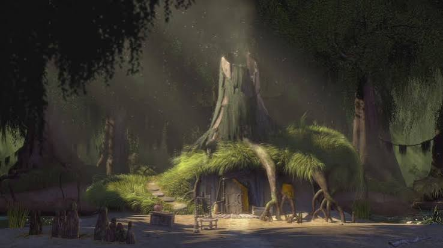

<h2 align="center"> About Me </h2>

  Hi! I'm Jhon Denver, a 3rd-year BS Computer Science student who balances code with an active lifestyle. Standing at 5'8", when I'm not studying or building software projects, you can find me on the basketball court, hitting the gym, or taking a break playing Roblox. I'm a huge dog lover and a firm believer that nothing beats a hot bowl of goto after a solid workout session. 

<h2 align="center">🏍️ Motorcycle Motto 🏍️</h2>

  <i>"Four wheels move the body, but two wheels move the soul."</i>

  

